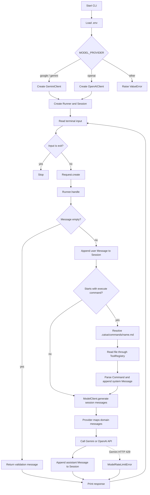
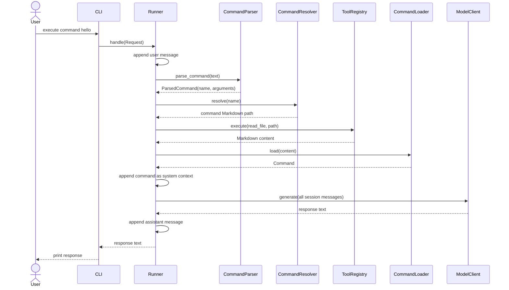

# Project structure

Current repository layout. Generated and local-only artifacts (`.git`, `.venv`,
`.env`, `__pycache__`, and `*.egg-info`) are omitted.

```text
caisa_harnes_project/
├── .caisa/
│   ├── CAISA.md
│   └── commands/{hello.md,test_write_file.md}
├── .env.example
├── .gitignore
├── README.md
├── config/
│   ├── agents/AGENTS.md
│   ├── harness/HARNESS.md
│   ├── rules/RULES.md
│   ├── tools/TOOLS.md
│   └── workflows/WORKFLOWS.md
├── data/{cache,logs,memory}/
├── doc/project_strucrure.md
├── main.py
├── prompts/{agents,system,workflows}/
├── pyproject.toml
├── scripts/
├── src/harness/
│   ├── application/
│   │   ├── commands/{loader/loader.py,parser/parser.py,resolver/resolver.py}
│   │   ├── entrypoints/
│   │   │   ├── api/{requests/parser.py,responses/builder.py,routes/router.py}
│   │   │   └── cli/{commands/handler.py,input/reader.py,output/writer.py,main.py}
│   │   ├── orchestration/
│   │   │   ├── engine/{lifecycle/lifecycle.py,loop/loop.py,runner/runner.py}
│   │   │   ├── routing/{dispatcher/dispatcher.py,resolver/resolver.py}
│   │   │   └── state/{session/state.py,task/state.py}
│   │   └── request/model/request.py
│   ├── domain/
│   │   ├── commands/model.py
│   │   ├── messages/{message/model.py,role/model.py}
│   │   ├── sessions/{session/model.py,state/model.py}
│   │   ├── tasks/{status/model.py,task/model.py}
│   │   └── tool_calls/{call/model.py,result/model.py}
│   ├── execution/
│   │   ├── tools/
│   │   │   ├── contracts/tool.py
│   │   │   ├── filesystem/{edit,read,search,write}/tool.py
│   │   │   ├── git/{commit,diff,history,status}/tool.py
│   │   │   ├── registry/{registration/registry.py,schemas/schema.py,registry.py}
│   │   │   ├── shell/{execution/tool.py,result/model.py}
│   │   │   └── testing/{result/model.py,runner/tool.py}
│   │   └── workflows/
│   │       ├── code_review/{finish,inspect,review,start}/step.py
│   │       ├── debugging/{diagnose,inspect,repair,verify}/step.py
│   │       └── feature/{analyze,implement,plan,verify}/step.py
│   ├── infrastructure/
│   │   ├── memory/
│   │   │   ├── persistence/{cache/cache.py,store/store.py}
│   │   │   ├── project/{reader/reader.py,writer/writer.py}
│   │   │   └── session/{reader/reader.py,writer/writer.py}
│   │   ├── observability/
│   │   │   ├── logging/{events/events.py,logger/logger.py}
│   │   │   ├── metrics/{collector/collector.py,usage/usage.py}
│   │   │   └── tracing/{spans/spans.py,tracer/tracer.py}
│   │   └── security/
│   │       ├── approvals/{decision/decision.py,request/request.py}
│   │       └── permissions/{checker/checker.py,rules/rules.py}
│   └── intelligence/
│       ├── agents/
│       │   ├── architect/{decisions/decisions.py,planner/planner.py,runner/runner.py}
│       │   ├── base/{contract/contract.py,lifecycle/lifecycle.py,state/state.py}
│       │   ├── coding/{instructions/loader.py,planner/planner.py,runner/runner.py}
│       │   ├── debugging/{diagnosis/diagnosis.py,repair/repair.py,runner/runner.py}
│       │   ├── review/{analyzer/analyzer.py,findings/builder.py,runner/runner.py}
│       │   └── testing/{planner/planner.py,runner/runner.py,verifier/verifier.py}
│       ├── context/
│       │   ├── building/{builder/builder.py,instructions/loader.py,messages/builder.py}
│       │   ├── compression/{budget/manager.py,summarizer/summarizer.py}
│       │   ├── retrieval/{files,memory,search}/retriever.py
│       │   └── window/{manager/manager.py,tokens/counter.py}
│       └── models/
│           ├── contracts/{model/contract.py,request/model.py,response/model.py,errors.py}
│           ├── providers/
│           │   ├── anthropic/{client/client.py,mapping/mapper.py,tools/mapper.py}
│           │   ├── google/{client/client.py,mapping/mapper.py}
│           │   ├── local/{client/client.py,mapping/mapper.py}
│           │   └── openai/{client/client.py,mapping/mapper.py,tools/mapper.py}
│           └── routing/{fallback/fallback.py,router/router.py,selector/selector.py,strategy/strategy.py}
└── tests/
    ├── evals/
    ├── integration/
    ├── unit/{__init__.py,test_cli_main.py}
    └── __init__.py
```

## Main responsibilities

- `application` owns entry points, command handling, requests, and orchestration.
- `domain` contains framework-independent domain models.
- `intelligence` contains agents, context management, and model integrations.
- `execution` contains executable tools and workflow steps.
- `infrastructure` contains persistence, observability, and security adapters.
- `tests` separates unit, integration, and evaluation coverage.

## Current implementation summary

The project currently implements a small, stateful command-line AI harness. A
single `Runner` keeps the conversation in memory, optionally loads a Markdown
command from `.caisa/commands/`, and sends the accumulated messages to Gemini
or OpenAI. Most of the larger architecture shown above is scaffolding: many
agent, workflow, API, infrastructure, and tool modules are currently empty.

### Implemented objects and responsibilities

| Object or function | Location | Responsibility and current logic |
|---|---|---|
| `Request` | `application/request/model/request.py` | Immutable application input containing the user's message and a UTC creation timestamp. `Request.create()` supplies the timestamp. |
| `Runner` | `application/orchestration/engine/runner/runner.py` | Central application orchestrator. Owns one in-memory `Session`, command services, and a tool registry. Validates input, stores messages, loads optional command context, calls the selected model, and stores the response. |
| `ParsedCommand` / `parse_command()` | `application/commands/parser/parser.py` | Recognizes input beginning with `execute command` (case-insensitive), separates the command name and arguments, and rejects a missing command name. Arguments are parsed but are not used by `Runner` yet. |
| `CommandResolver` | `application/commands/resolver/resolver.py` | Maps a command name to `.caisa/commands/<name>.md` and rejects unknown commands. |
| `CommandLoader` | `application/commands/loader/loader.py` | Parses Markdown sections headed by `# `. Requires `Name` and `Description`; stores every other section in `Command.sections`. |
| `Command` | `domain/commands/model.py` | Immutable command definition: name, description, and additional Markdown sections. |
| `Message` | `domain/messages/message/model.py` | Immutable conversation message. Its role is restricted to `user`, `assistant`, or `system`. |
| `Session` | `domain/sessions/session/model.py` | Mutable in-memory conversation with a generated UUID and ordered messages. It is created once per `Runner`; there is no persistence or reset behavior yet. |
| `ToolCall` | `domain/tool_calls/call/model.py` | Immutable name-and-arguments representation for a future model-requested tool call. It is not connected to the model loop yet. |
| `ModelClient` | `intelligence/models/contracts/model/contract.py` | Provider-neutral protocol requiring `generate(messages) -> str`. This is the boundary used by `Runner`. |
| `create_model_client()` | `intelligence/models/routing/selector/selector.py` | Selects Gemini for `google`/`gemini` (the default) or OpenAI for `openai`, using `MODEL_PROVIDER`. Other values fail immediately. |
| `GeminiClient` | `intelligence/models/providers/google/client/client.py` | Reads `GEMINI_API_KEY` and optional `GEMINI_MODEL`, maps messages to the Google SDK, calls `generate_content`, and converts HTTP 429 errors into `ModelRateLimitError`. |
| Google `map_messages()` | `intelligence/models/providers/google/mapping/mapper.py` | Converts assistant messages to Gemini's `model` role, keeps user messages as `user`, and combines all system messages into one system instruction. |
| `OpenAIClient` | `intelligence/models/providers/openai/client/client.py` | Uses the OpenAI Responses API and optional `OPENAI_MODEL`, maps the session messages, and returns `response.output_text`. |
| OpenAI `map_messages()` | `intelligence/models/providers/openai/mapping/mapper.py` | Converts domain messages into dictionaries containing `role` and `content`. |
| `ModelRateLimitError` | `intelligence/models/contracts/errors.py` | Provider-neutral error currently used for Gemini quota/rate-limit failures and handled by the packaged CLI. |
| `Tool` | `execution/tools/contracts/tool.py` | Protocol for named tools with a description and `execute(arguments) -> str`. |
| `ToolRegistry` | `execution/tools/registry/registry.py` | Registers unique tools, resolves tools by name, executes them, and lists registered instances. |
| `register_tools()` | `execution/tools/registry/registration/registry.py` | Registers `ReadFileTool` and `WriteFileTool` in each `Runner`. |
| `ReadFileTool` | `execution/tools/filesystem/read/tool.py` | Validates a string path, requires an existing file, and returns its UTF-8 text. The runner uses it internally to load command files. |
| `WriteFileTool` | `execution/tools/filesystem/write/tool.py` | Validates path/content strings, creates parent directories, writes UTF-8 text, and returns a success message. It is registered but cannot currently be invoked by a model response. |
| `CAISAPromptLoader` | `intelligence/context/building/instructions/loader.py` | Reads `.caisa/CAISA.md`, returning an empty string if absent. It exists but is not currently used by `Runner`, so the project instructions are not sent to the model. |
| `read_input()` | `application/entrypoints/cli/input/reader.py` | Reads and trims one terminal message. EOF or Ctrl+C is converted into `exit`. |
| CLI `main()` | `application/entrypoints/cli/main.py` | Loads `.env`, creates the selected model and runner, runs the prompt loop, stops on `exit`, and reports model rate-limit errors without ending the process. |

## Runtime workflow schema



### Command execution sequence



## State and data flow

1. The CLI converts raw terminal text into a timestamped `Request`.
2. `Runner` converts the request into a domain `Message` and appends it to its
   long-lived `Session`.
3. Normal messages go directly to the model. Command messages first add a
   generated `system` message based on the selected Markdown command.
4. The provider mapper converts domain messages into SDK-specific input.
5. The provider response is stored as an `assistant` message, making it part of
   the next request's context.
6. All session state is process-local and is lost when the CLI exits.

## Implemented versus planned

### Working now

- Interactive CLI conversation loop.
- In-memory multi-turn conversation history.
- Gemini and OpenAI provider selection.
- Markdown command detection, resolution, loading, and prompt injection.
- Internal read/write filesystem tools and a reusable registry.
- Friendly Gemini quota error handling in the packaged CLI.

### Scaffolded but not implemented

- HTTP API routes, request parsing, and response building.
- Agent types (`coding`, `review`, `testing`, `debugging`, and `architect`).
- Context building, retrieval, compression, token counting, and window control,
  except for the unused `CAISAPromptLoader`.
- Feature, debugging, and code-review workflow steps.
- Shell, Git, testing, search, and edit tools.
- Memory persistence, project/session storage, logs, metrics, and tracing.
- Approval and permission enforcement.
- Anthropic and local model providers.
- Task/session state models beyond the implemented in-memory `Session`.
- Integration and evaluation tests.

## Important current limitations

- The model can only return text. `ToolCall` is not parsed or executed, so a
  command that asks the model to use `write_file` cannot actually trigger it.
- `.caisa/CAISA.md` is not loaded into the session even though a loader exists.
- Parsed command arguments are discarded by `Runner`.
- Command names are used to construct filesystem paths without explicit
  project-root containment validation.
- Read/write tools accept unrestricted paths; the security scaffolding is empty.
- Provider calls are synchronous and have no retry, timeout, streaming, or
  general provider-error translation.
- `main.py` at the repository root duplicates the packaged CLI but does not
  handle `ModelRateLimitError`.
- The existing CLI unit test mocks input but not model construction and expects
  behavior that no longer matches the current implementation; it is stale.
- `pyproject.toml` declares only `openai`, while the implemented CLI also imports
  `python-dotenv` and the Google Gen AI SDK.
